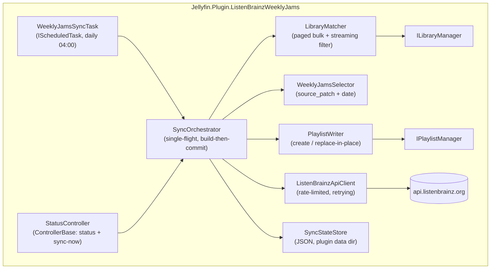
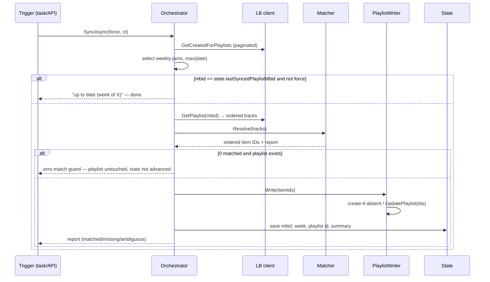

# Design — ListenBrainz Weekly Jams for Jellyfin

| | |
|---|---|
| **Status** | Draft v1.0 — for review |
| **Date** | 2026-10-21 |
| **Inputs** | `docs/requirements.md` v0.5 (all questions resolved), dry-run results (Appendix A.3), OQ-5 benchmark (`benchmarks/oq5-bench/`), Jellyfin `v10.11.9` source verification |

All Jellyfin APIs referenced below were verified against the `v10.11.9` source — see
Appendix B for the exact signatures.

---

## 1. Architecture



All components are registered as singletons via `IPluginServiceRegistrator`
(`PluginServiceRegistrator.cs`). The scheduled task and API controller are
discovered by Jellyfin through their interfaces.

## 2. Module layout

```
Jellyfin.Plugin.ListenBrainzWeeklyJams/
├── Plugin.cs                        # done (M0)
├── PluginServiceRegistrator.cs      # DI registrations
├── Configuration/
│   ├── PluginConfiguration.cs       # done (M0); M3 adds owner + visibility
│   └── configPage.html              # M3: owner select, visibility, sync-now, status
├── ListenBrainz/
│   ├── ListenBrainzApiClient.cs     # HTTP, rate limit, retry, UA
│   ├── ListenBrainzModels.cs        # verified JSPF DTOs
│   └── WeeklyJamsSelector.cs        # FR-07 selection
├── Matching/
│   ├── NameNormalizer.cs            # C# port of dry_run norm() (D-11)
│   ├── LibraryMatcher.cs            # OQ-5/OQ-6 strategy
│   └── ILibraryQueryFacade.cs       # thin query abstraction (D-16)
├── Playlists/
│   └── PlaylistWriter.cs            # FR-16..20
├── Sync/
│   ├── SyncOrchestrator.cs          # pipeline + short-circuit (FR-24/25)
│   ├── SyncStateStore.cs            # D-9
│   ├── SyncReport.cs                # FR-15/23 result model
│   └── WeeklyJamsSyncTask.cs        # IScheduledTask (FR-21/22)
├── Api/
│   └── StatusController.cs          # config-page status + forced sync
└── Jellyfin.Plugin.ListenBrainzWeeklyJams.Tests/   # separate project
    ├── NameNormalizerTests.cs       # ported from scripts/test_dry_run.py
    ├── SelectorTests.cs             # runs against recorded LB fixtures
    ├── MatcherTests.cs              # facade injected with fake pages
    └── TestData/                    # recorded LB payloads (from dry run)
```

## 3. Component specifications

### 3.1 ListenBrainzApiClient (M1)

- Constructed with `IHttpClientFactory` (Jellyfin's, `NamedClient.Default`) and
  `ILogger<ListenBrainzApiClient>`.
- **User-Agent (FR-09):**
  `Jellyfin.Plugin.ListenBrainzWeeklyJams/{assembly version} (https://github.com/tabjy/jellyfin-listenbrainz-recommendations-plugin)`
- **Rate limiting (FR-10):** `SemaphoreSlim(1,1)` + monotonic clock enforcing
  ≥ 1.0 s between requests. On `429`: sleep `X-RateLimit-Reset-In` + 0.5 s,
  retry (max 5).
- **Retries (NFR-05):** 5xx / network errors → exponential backoff (2^n s),
  3 attempts, then fail with an actionable message.
- 30 s per-request timeout; `CancellationToken` plumbed everywhere.
- **Endpoints:**
  - `GET /1/user/{user}/playlists/createdfor?offset=N` — paginate until
    `offset >= playlist_count` (FR-06; verified: page size 25, real users exceed it).
  - `GET /1/playlist/{mbid}` — full detail (FR-08).
- **Models (ListenBrainzModels.cs):** match the *verified live shapes* (no
  `payload` wrapper — see requirements §2.1): top-level `{count, offset,
  playlist_count, playlists: [{playlist: JspfPlaylist}]}` and `{playlist:
  JspfPlaylist}` for detail. `JspfPlaylist` carries `title`, `date`, `identifier`
  (MBID URL), and the extension object with `algorithm_metadata.source_patch`,
  `created_for`. `JspfTrack` carries `identifier[0]` (recording MBID URL),
  `title`, `creator`, `album`, and artist credits with `artist_mbid`.
  Deserialization: `System.Text.Json` with `JsonSerializerOptions` tolerant of
  the extension key `"https://musicbrainz.org/doc/jspf#playlist"`.
- **Error mapping (FR-11):** HTTP 404 on the user → *"ListenBrainz user not
  found"*; no `weekly-jams` entries → *"no Weekly Jams playlist yet (new
  account?)"*; exhausted retries → *"ListenBrainz unreachable"*.

### 3.2 WeeklyJamsSelector (M1)

Pure function over the created-for-you list (unit-tested against recorded
fixtures):

1. Filter `source_patch == "weekly-jams"` (structured type ID, verified).
2. Pick max `date` (parsed as `DateTimeOffset`; ISO-8601 with identical
   timezone offsets — string compare would also be safe, but parsing is explicit).
3. Defensive fallback (FR-07): if extension metadata is absent on an entry,
   fall back to title prefix `Weekly Jams for `. Never parse week dates from
   titles.
4. Returns the selected playlist summary (MBID, title, date).

### 3.3 SyncStateStore (D-9)

JSON file `state.json` in the plugin's data path (`BasePlugin.DataPath`),
created on first save. State ≠ configuration: it changes every sync and is
machine-managed, so it does not live in `PluginConfiguration`.

```json
{
  "lastSyncedPlaylistMbid": "e3d029d6-d8bc-4443-ad64-79fc442c1088",
  "lastSyncedWeek": "2026-10-12",
  "lastSyncAtUtc": "2026-10-21T04:00:12Z",
  "jellyfinPlaylistId": "0a1b2c3d-...",
  "lastSummary": { "total": 50, "matched": 48, "viaMbid": 45, "viaName": 3, "missing": 2, "ambiguous": 11 }
}
```

Atomic writes (temp file + `File.Move`). Read failures are logged and treated
as "no state" (safe: worst case is one redundant full sync).

### 3.4 SyncOrchestrator (M3)

`Task<SyncReport> SyncAsync(bool force, CancellationToken ct)` — **single-flight**
(`SemaphoreSlim(1,1)`): concurrent invocations log *"sync already running"* and
return immediately (D-13). This is what makes task-trigger vs config-button
races harmless.

```
 1. Validate config: username non-empty (FR-01) → fail with clear message
 2. Fetch created-for-you list (paginated)
 3. Select latest weekly-jams (3.2)
 4. SHORT-CIRCUIT (FR-25): !force && state.lastSyncedPlaylistMbid == selected.Mbid
       → log "up to date (week of {week})", return; 1–2 LB requests spent
 5. Fetch playlist detail → ordered tracks (FR-08/14)
 6. Match (3.5) → ordered item IDs + per-track report (FR-12..15)
 7. ZERO-MATCH GUARD (FR-18): 0 matched && playlist exists
       → warn, leave playlist untouched, DO NOT advance state (next run retries)
 8. Write playlist (3.6): create-if-absent, replace-in-place
 9. Save state (mbid, week, time, playlist id, summary)  (FR-24)
10. Log one summary line + missing-track list (FR-23, NFR-06)
```

Build-then-commit: steps 2–6 complete before any playlist mutation, so any
failure leaves the existing playlist untouched (NFR-05). The zero-match guard
deliberately does not advance state so the next run retries the same week.

### 3.5 LibraryMatcher (M2)

**Phase 1 — MBID, paged bulk with streaming filter (OQ-5):**

```
mbidSet    = HashSet of the playlist's recording MBIDs (~50)
candidates = Dictionary<mbid, List<Audio>>
page through ILibraryManager.GetItemList:
    InternalItemsQuery {
        IncludeItemTypes  = [Audio],
        HasAnyProviderId = { ["MusicBrainzRecording"] = null },   // "has this provider"
        StartIndex, Limit = 5000
    }
    per page: keep items whose ProviderIds["MusicBrainzRecording"] ∈ mbidSet
              (all of them — ambiguity data feeds OQ-6); discard the page
```

Memory bounded by page size + candidate count, independent of library size.
Measured (OQ-5 benchmark): ~0.7 s for 19k items; ~1.8 s projected at 50k —
NFR-03 met with ~30× headroom.

**Phase 2 — name fallback, per-miss only (2–3 per sync in practice):**

For each track that failed MBID resolution, query by title (`InternalItemsQuery`
`Name` exact, then `NameContains`) and apply the tier logic in memory over the
small candidate set:

- **T1** exact normalized (artist, title)
- **T2** bracket-stripped (ignores "(Remastered 2011)")
- **T3** bracket-stripped title + artist containment ("The Beatles" ↔ "Beatles")
- tiebreak: artist MBID against `ProviderIds["MusicBrainzArtist"]` (FR-13 should)

**Phase 3 — OQ-6 pick policy:** exact normalized-title match first, else lowest
Jellyfin item Id. Ambiguities counted and logged.

**NameNormalizer (D-11):** faithful C# port of `scripts/dry_run.py: norm()`,
including the compatibility-folding rule discovered during the dry run —
per-character NFKD; combining marks are stripped only over ASCII-letter bases
(`é → e`); kana stay precomposed so dakuten survive (`で` must not become `て`);
full decompositions kept (`fi → fi`). Then: casefold, `feat`/`ft`/`featuring`
suffix strip, punctuation → space, whitespace collapse. All 16 dry-run tests
(including the dakuten regression) port to C#.

**Testability (D-16):** the matcher pages through `ILibraryQueryFacade`
(a one-method wrapper around `ILibraryManager.GetItemList`), so unit tests
inject fake pages without a server.

### 3.6 PlaylistWriter (M3)

- **Exists check (FR-19):** `ILibraryManager.GetItemById(state.jellyfinPlaylistId)`
  as `Playlist`; null → create. (ID-tracked, never name-based — renames survive,
  AC-2.2.)
- **Create:** `IPlaylistManager.CreatePlaylist(new PlaylistCreationRequest {
    Name = config.PlaylistName, ItemIdList = itemIds, MediaType = Audio,
    UserId = ownerUserId, Public = config.IsPublic })` → remember `result.Id`
  in state (FR-16).
- **Replace-in-place (FR-17):** one call —
  `UpdatePlaylist(new PlaylistUpdateRequest { Id = playlistId, UserId = ownerUserId,
  Ids = newItemIds })`. Verified: replaces the item list; `Name: null` preserves
  user renames. Known imperfection: internally clears then re-adds, leaving a
  sub-second empty window — acceptable for a 04:00 task; no better path exists
  via the public API.
- **Owner/visibility (FR-03):** from config; owning user defaults to the first
  admin at sync time if unset.
- **Description (FR-20, should):** `PlaylistUpdateRequest` has no description
  field, so the week stamp goes via the `Playlist` entity's `Overview` +
  `IPlaylistManager.SavePlaylistFile` — exact persistence call to be verified
  in M3; drop the feature before contorting.

### 3.7 WeeklyJamsSyncTask (M3)

`IScheduledTask` — Name *"Sync ListenBrainz Weekly Jams"*, Category
*"Library"*, Key `ListenBrainzWeeklyJamsSync`. Default trigger (FR-21):
`TaskTriggerInfo { Type = TaskTriggerInfoType.DailyTrigger, TimeOfDayTicks = 4h }`.
`ExecuteAsync` validates config (invalid → error log + clean return, NFR-08),
runs the orchestrator with `force: false` (dashboard "Run now" therefore honors
the short-circuit), reports coarse progress (0/25/50/75/100).

### 3.8 StatusController + config page (M3)

- `GET /Plugins/ListenBrainzWeeklyJams/Status` — reads the state store: last
  sync time, outcome, week, counts (FR-04).
- `POST /Plugins/ListenBrainzWeeklyJams/SyncNow` — runs the orchestrator with
  `force: true` (FR-22/FR-25: the config-page button is the escape hatch that
  bypasses the short-circuit), awaits, returns the report. Admin-authorized.
- Config page additions: owner user select (`ApiClient.getUsers()`), visibility
  checkbox, Sync now button (posts the endpoint above), status line (polls the
  status endpoint).

## 4. Sync sequence (full path)



## 5. Failure semantics

| Failure | Behavior |
|---|---|
| LB 429/5xx/network | backoff + retries → clean task failure; playlist untouched |
| Unknown LB user / no jams yet | actionable error (FR-11) |
| Zero matched tracks | playlist untouched, state **not** advanced (FR-18) |
| Concurrent trigger | second invocation logs and exits (single-flight, D-13) |
| State file corrupt/missing | log + treat as first run |
| Config invalid at task time | error log, no crash (NFR-08) |

## 6. Logging (NFR-06)

One `Information` summary line per sync (`week of X: 48/50 matched (45 MBID, 3 name), 2 missing, 11 ambiguous, 1.2s`);
missing tracks listed at `Information` (`artist — title [mbid]`); ambiguities at
`Debug`; failures at `Error` with actionable messages. No per-track `Information` spam.

## 7. Testing strategy

- **Unit (xUnit, `…Tests` project):** normalizer (ported 16 cases incl. dakuten
  regression), selector (against recorded LB fixtures copied from the dry run),
  matcher (fake `ILibraryQueryFacade` pages: MBID hits, tiers, ambiguity, OQ-6
  ordering), state store round-trip, report formatting.
- **Fixtures:** the dry run's recorded payloads (`createdfor` pages + playlist
  detail) are checked into `Tests/TestData` — the account owner's private data
  in a private repo; acceptable. Regenerate via `scripts/dry_run.py
  --save-fixtures` if ever needed.
- **Integration (M3, manual):** install on the dev server, verify AC-1.1…5.2
  against the real account; the dry run already de-risked matching end-to-end.

## 8. Design decisions

Continues the numbering from requirements D-1…D-8.

| # | Decision | Rationale |
|---|---|---|
| D-9 | Sync state in `state.json` under the plugin data path, not `PluginConfiguration` | Config is user-editable; state changes every sync. Atomic writes; corrupt state = safe first-run behavior |
| D-10 | HTTP via Jellyfin's `IHttpClientFactory`; JSON via `System.Text.Json` | Server-managed connection pool; no extra dependencies |
| D-11 | Normalizer is a faithful port of the dry-run `norm()` incl. dakuten-preserving fold | Proven against a real library; regression-tested in two languages |
| D-12 | Replace-in-place via `UpdatePlaylist { Ids }` (single call, `Name: null`) | Verified: preserves user renames; one API call; sub-second empty window accepted |
| D-13 | Single-flight orchestrator (`SemaphoreSlim(1,1)`) | Task trigger and config-page button can race; second run exits with a log line |
| D-14 | Config-page Sync now = `POST …/SyncNow` running orchestrator with `force: true`; dashboard Run now = task path with short-circuit | FR-22/FR-25 exactly: the button is the documented force escape hatch |
| D-15 | `GET /Status` reads the state store for the config page | FR-04 without stuffing status into config |
| D-16 | `ILibraryQueryFacade` (one-method wrapper over `ILibraryManager.GetItemList`) | Matcher unit-testable without a server |

## 9. Milestone mapping

| Milestone | Components |
|---|---|
| M1 | `ListenBrainzApiClient`, models, `WeeklyJamsSelector`, fixtures, selector/client tests |
| M2 | `NameNormalizer`, `LibraryMatcher` (+facade), matcher tests (OQ-5/OQ-6 encoded) |
| M3 | `SyncStateStore`, `SyncOrchestrator`, `PlaylistWriter`, `WeeklyJamsSyncTask`, `StatusController`, config page extension, service registration |
| M4 | logging hygiene, README/docs polish, changelog, catalog readiness, full AC pass |

## Appendix B — Verified Jellyfin 10.11 API cheat sheet

From `v10.11.9` source (see requirements Appendix A for LB facts):

```csharp
// IPlaylistManager (MediaBrowser.Controller/Playlists/IPlaylistManager.cs)
Task<PlaylistCreationResult> CreatePlaylist(PlaylistCreationRequest request);
Task UpdatePlaylist(PlaylistUpdateRequest request);   // Ids != null → replace items; Name == null → preserved
Playlist GetPlaylistForUser(Guid playlistId, Guid userId);
Task AddItemToPlaylistAsync(Guid playlistId, IReadOnlyCollection<Guid> itemIds, Guid userId);
Task RemoveItemFromPlaylistAsync(string playlistId, IEnumerable<string> entryIds);
void SavePlaylistFile(Playlist item);

// PlaylistCreationRequest: Name, ItemIdList (IReadOnlyList<Guid>), MediaType (Jellyfin.Data.Enums),
//                         UserId, Users, Public (bool?, default false)
// PlaylistCreationResult: Id (string)
// PlaylistUpdateRequest: Id, UserId, Name (nullable), Ids (nullable), Users, Public
// UpdatePlaylistImpl: clears LinkedChildren, persists, re-adds — verified Emby.Server.Implementations/Playlists/PlaylistManager.cs L589

// Playlist entity: GetManageableItems() → IReadOnlyList<Tuple<LinkedChild, BaseItem>> (entry IDs for RemoveItemFromPlaylistAsync)

// ILibraryManager: GetItemList(InternalItemsQuery) — supports IncludeItemTypes,
//   HasAnyProviderId (empty value = "has provider set"), StartIndex/Limit paging

// IScheduledTask (MediaBrowser.Model.Tasks): Name, Key, Description, Category,
//   Task ExecuteAsync(IProgress<double>, CancellationToken);
//   IEnumerable<TaskTriggerInfo> GetDefaultTriggers();
// TaskTriggerInfo { Type = TaskTriggerInfoType.DailyTrigger, TimeOfDayTicks = TimeSpan ticks }

// IPluginServiceRegistrator (MediaBrowser.Controller.Plugins):
//   void RegisterServices(IServiceCollection, IServerApplicationHost); // parameterless ctor
```
